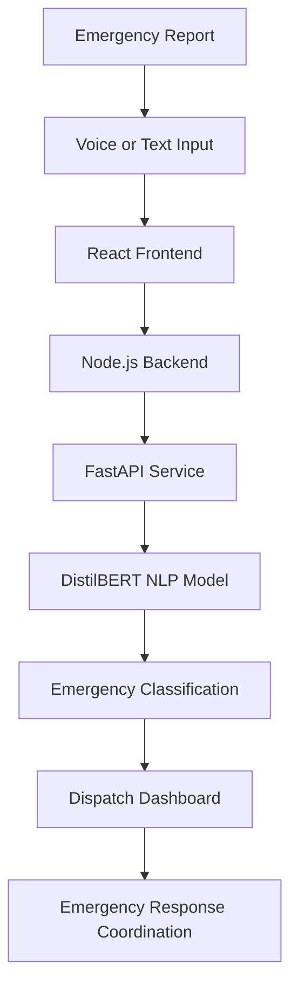

# 🚨 Rapid-100 – AI-Powered Emergency Triage and Response System

## 📌 Project Overview

Rapid-100 is an AI-powered emergency triage and response system designed to classify emergency requests and assist emergency response teams in making faster and more informed decisions.

The platform uses Natural Language Processing (NLP) and the DistilBERT model to analyze text and voice-based emergency reports, identify emergency categories, and support efficient response coordination through a centralized dispatch dashboard.

## 🎯 Objectives

- Reduce delays in emergency request classification.
- Automate emergency identification using Artificial Intelligence.
- Support both voice and text-based emergency reporting.
- Assist emergency operators in coordinating appropriate responses.
- Minimize manual workload and improve operational efficiency.

## ✨ Key Features

- **AI-Based Emergency Classification:** Classifies emergency reports using the DistilBERT NLP model.
- **Voice-Based Reporting:** Allows users to provide emergency information through microphone input.
- **Text-Based Reporting:** Supports emergency descriptions through text input.
- **Emergency Dispatch Dashboard:** Provides a centralized interface for managing emergency requests.
- **Performance Metrics:** Displays emergency-related statistics and operational metrics.
- **API Integration:** Enables communication between the frontend, backend, and AI model.
- **Interactive User Interface:** Provides a user-friendly interface for emergency reporting and monitoring.

## 🧠 Emergency Classification Categories

| Category | Description |
|---|---|
| MEDICAL | Medical emergencies and health-related incidents |
| FIRE | Fire-related emergencies |
| ACCIDENT | Road accidents and other accident-related incidents |
| SECURITY | Security threats and public safety incidents |
| GENERAL_HELP | General assistance and support requests |

## 🛠️ Tech Stack

| Component | Technologies |
|---|---|
| Frontend | React.js, Vite, JavaScript, CSS |
| Backend | Node.js |
| AI Backend | Python, FastAPI |
| Machine Learning | DistilBERT |
| NLP | Hugging Face Transformers |
| Communication | REST API |
| Version Control | Git, GitHub |
| Development Environment | Visual Studio Code |

## ⚙️ System Architecture

## 🔄 Working Principle

1. The user submits an emergency report through voice or text input.
2. The emergency information is transmitted to the backend.
3. The AI service processes the emergency text.
4. The DistilBERT model predicts the appropriate emergency category.
5. The classification result is displayed on the dispatch dashboard.
6. Emergency operators review the information and coordinate the appropriate response.

## 🤖 AI Model

Rapid-100 utilizes **DistilBERT**, a lightweight transformer-based Natural Language Processing model, for emergency text classification.

The model analyzes the context of emergency descriptions and categorizes them into predefined emergency classes.

### Advantages of DistilBERT

- Lightweight transformer architecture.
- Efficient text classification.
- Context-aware language understanding.
- Faster inference compared to larger BERT models.
- Suitable for NLP-based emergency classification applications.

## 🌐 Applications

- Emergency response centers.
- Ambulance coordination systems.
- Fire and rescue services.
- Police and public safety departments.
- Smart city emergency management.
- Disaster response management.

## 🚀 Future Enhancements

- GPS-based emergency location tracking.
- Multilingual emergency reporting.
- Emergency severity and priority prediction.
- Real-time ambulance and rescue vehicle tracking.
- Automated emergency notifications.
- Integration with official emergency response services.
- Mobile application development.

## 🏆 Hackathon

This project was developed as part of **Infinitum 2026 – Rapid-100 Hackathon** and was shortlisted for the second round.

## 📖 Project Status

Rapid-100 is an academic hackathon prototype demonstrating the application of Artificial Intelligence, Natural Language Processing, and full-stack development in emergency response management.

The system is intended to assist human operators and is not a replacement for official emergency services or professional emergency assessment.

## 👩‍💻 Contributor

**Kiruthika Loganathan**

- B.Tech – Artificial Intelligence and Data Science
- KPR Institute of Engineering and Technology
- GitHub: [kiruthika569](https://github.com/kiruthika569)

---

⭐ If you find this project interesting, consider giving the repository a star!

**Rapid-100 – Leveraging Artificial Intelligence for Faster and Smarter Emergency Response.**
